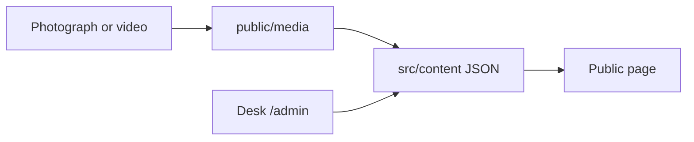
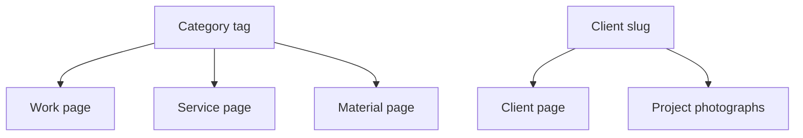
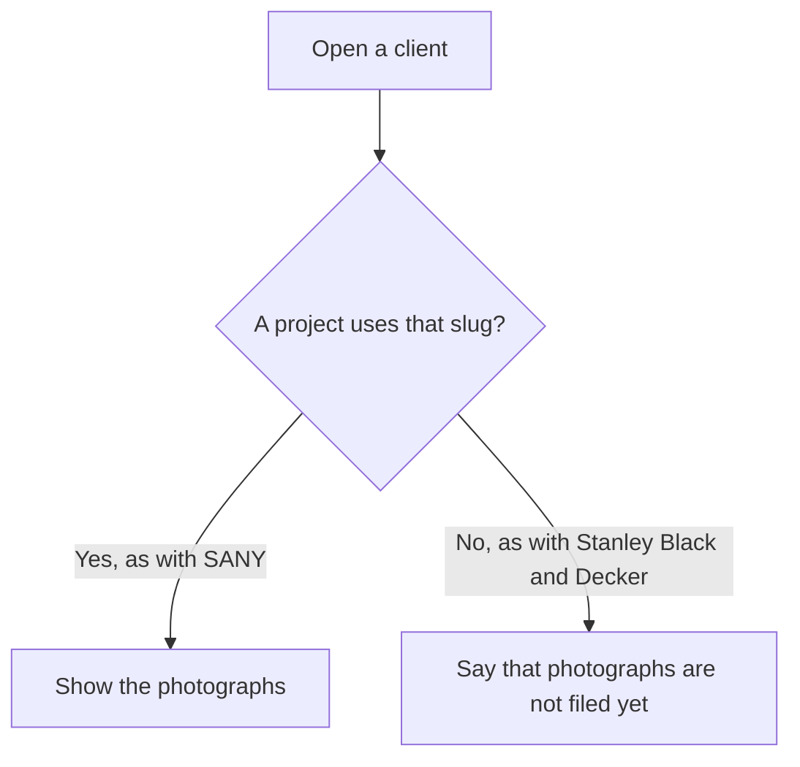
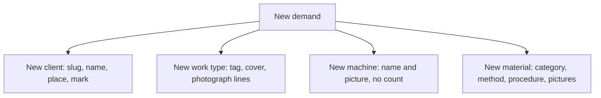
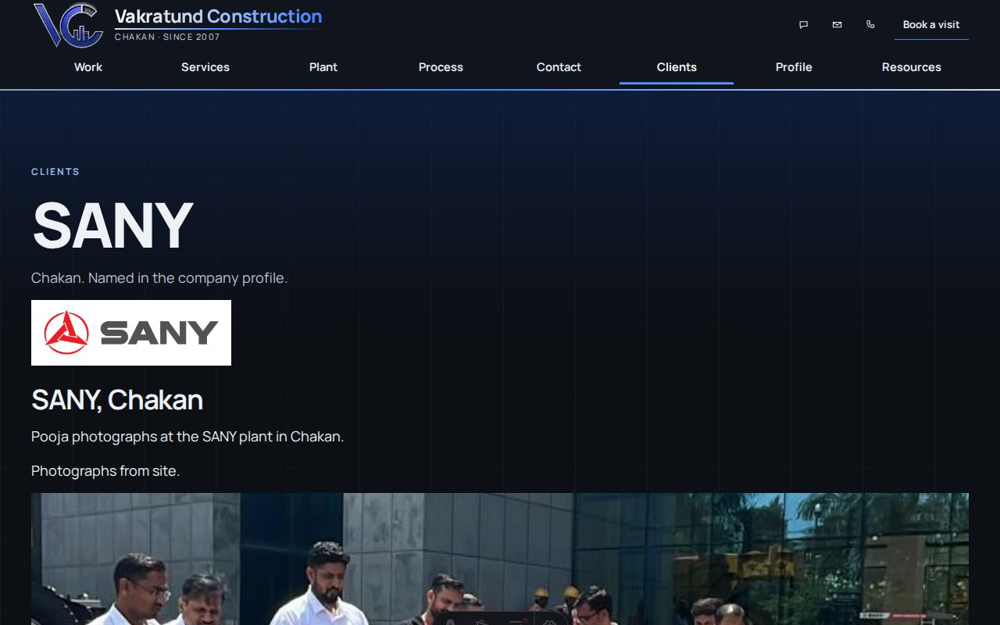
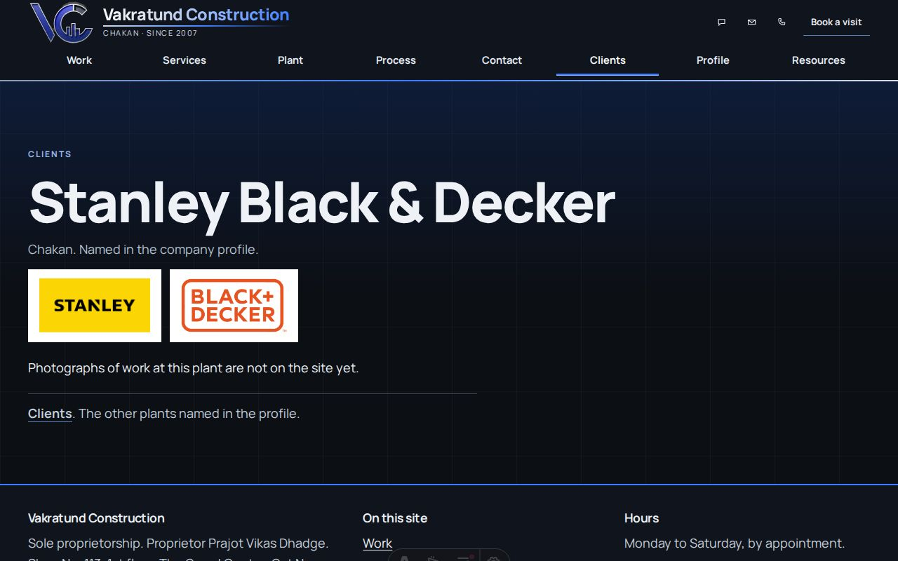
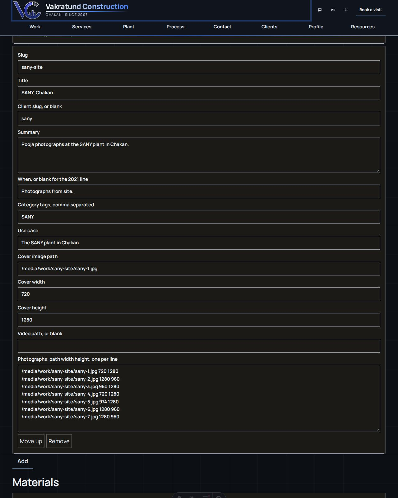
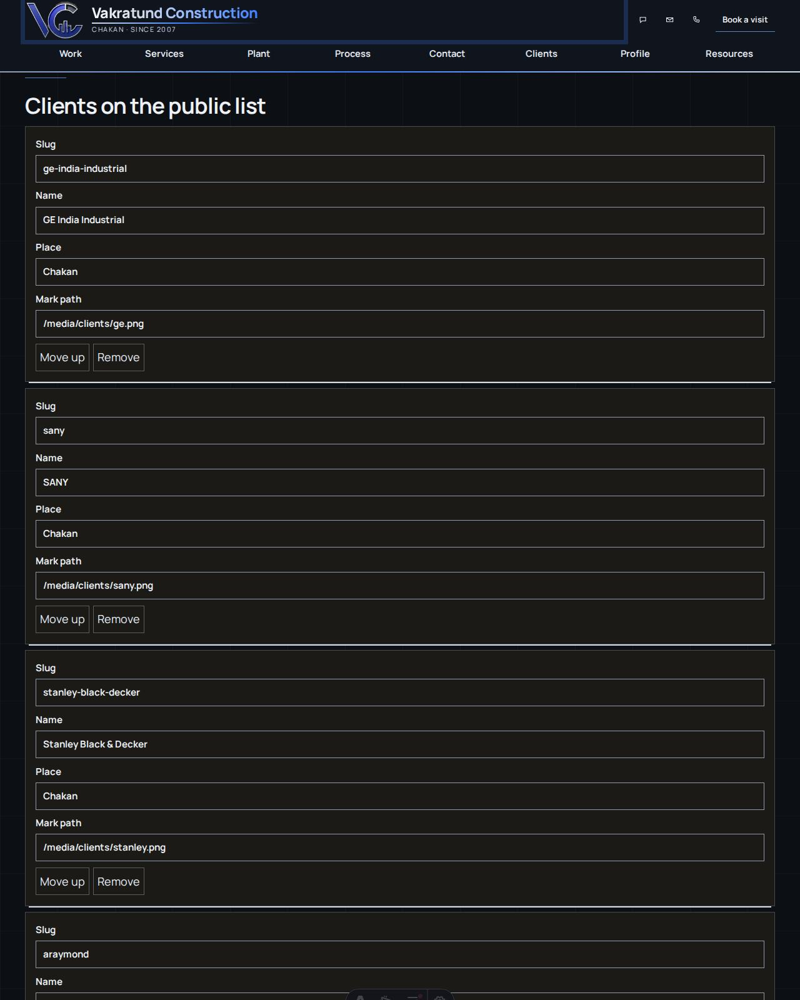
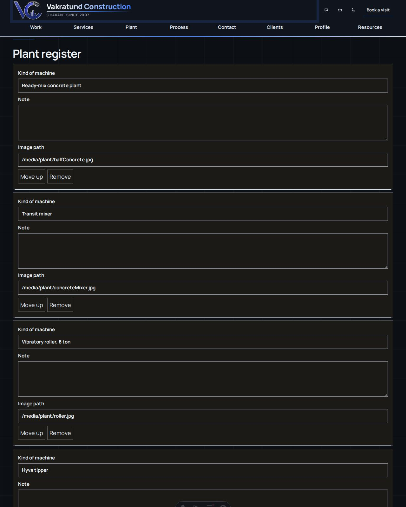

# How the pages are edited

The public pages read JSON in `src/content`. The desk at `/admin` edits that JSON on a computer running the site. A published build shows the last copy. The published desk refuses a save.

The password is not written in this file. It stays with the person who runs the computer.



## Where a file goes

| What you are adding | Put the file here | Desk list | Field |
|---|---|---|---|
| Home film frame | `public/media/work/sany-site/` | Home hero slides | Image path, width, height |
| Work for one client | `public/media/work/<client-slug>/` | Projects | Client slug, then photograph lines `path width height` |
| Client mark | `public/media/clients/` | Clients | Mark path |
| Cover of a work type | `public/media/made/` or `public/media/work/` | Projects | Cover image path |
| Kind of machine | `public/media/plant/` | Plant register | Image path. No count |
| Material pictures | `public/media/work/` or `public/media/gallery/` | Materials | Image path, then more paths, one per line |
| Service card | `public/media/made/` | Services | Image path |
| Video | `public/media/video/name.mp4` | Projects | Video path. Blank means no player |

A photograph line is three tokens: the path, the width in pixels, the height in pixels. One photograph per line.

```text
/media/work/sany-site/sany-7.jpg 1280 960
```

## Categories

A category tag joins a work page, a service page, and a material page. The tags in use are `road`, `foundation`, `floor`, `wall`, `yard`, and `building`.

A client page does not use that tag. It uses the project field Client slug.



## SANY, and Stanley Black & Decker

SANY is the filled example. The client slug is `sany`. The project `sany-site` has the same client slug, so `/clients/sany` shows the pooja photographs.

Stanley Black & Decker is one client in the company profile. The slug is `stanley-black-decker`. Both marks are on `/clients/stanley-black-decker`. No photographs of work at that plant are filed. To add them:

1. Put the files in `public/media/work/stanley-black-decker/`.
2. Add a project.
3. Set Client slug to `stanley-black-decker`.
4. List each file as `path width height`.
5. Publish a new build.



## Text you can change without a new page

Office lines, the home lead, the tagline, the measure, the safety line, the mission, the phone, and the proprietor are single fields at the top of the desk. Menu names are the Menu pages list. Process steps are the Process steps list. Resource notes are the Resources list.

## A new demand



Leave Client slug blank when the photographs belong to the 2021 portfolio and no plant is named. Those pages keep the sentence that the photographs are of jobs done in 2021.

A new sentence still needs a source in `docs/sources.md`. Do not add a certificate, a turnover, a staff count, a rate, or a project value that the profile, the office note, or a labelled photograph does not state.

## Screenshots

These files are also on the public guide at `/guide`.










